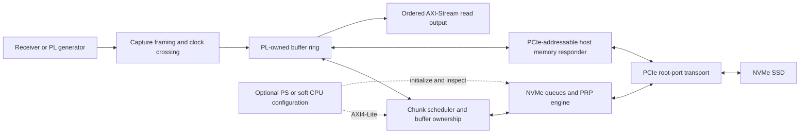

# Architecture proposal and contracts

Status: design baseline for qualification; public register/descriptor ABI is not
frozen until work package W02. No signal naming below claims an implemented port.

## CPU-free does not mean memory-free

For writes, the host stores a command in a submission queue, rings an SSD
doorbell, and the SSD fetches the command and PRP-addressed payload using PCIe
Memory Reads. The FPGA returns Completion-with-Data packets. For reads, the SSD
writes payload and completion entries into FPGA-owned address space. Queues and
payload therefore need stable addressable backing storage. A FIFO alone cannot
serve arbitrary legal SSD DMA access ordering.

The ring should use PL-attached DDR through an AXI memory backend, with small
BRAM FIFOs for elastic buffering and CDC. The public ingress/egress remains AXIS.
Queue/control structures can remain in BRAM. Firmware is allowed to enumerate
and configure; it must then be removable/idle without stopping I/O.

Single-drive MVP deliberately uses one physical function and one supported
namespace, direct root-port attachment, polling CQ memory, and no dependence on
MSI/MSI-X. Disable/mask interrupts consistently. Later add interrupts for software
observation, never as a requirement for hardware completion processing.

## Buffer lifetime is the central invariant

Write buffer states: FREE → FILLING → READY → SUBMITTED → COMPLETED → FREE.
Do not submit a descriptor before its whole payload is committed/visible. Do not
reuse a submitted buffer until matching completion and all required memory
responses have retired. Multiple independent slots overlap capture, DMA and CQ
handling. PRP lists and SQ entries remain immutable while the SSD can fetch them.
Account for both memory bandwidth directions: capture writes plus SSD fetches
already require at least twice the payload rate, before refresh/arbitration.

Read buffer states: FREE → SUBMITTED → COMPLETED → DRAINING → FREE. Expose data
only after successful completion/visibility. Match completions by CID, SQID and
reset epoch; do not assume completion order. Reorder output to descriptor order
for the simple stream API. Free after the final downstream handshake.

On timeout/link loss, submitted writes have an unknown outcome. Quarantine their
buffers, fence/reset the transport, invalidate the old epoch and record a capture
gap before reinitializing. A stale CQE must never free new data. Do not blindly
retry a write or report success. Camera input continues only while storage exists.

## Draft public interfaces

| Interface | Proposed contract |
|---|---|
| Write payload | AXI4-Stream; 256 bits default; `TKEEP` for final partial beat; `TLAST` ends the descriptor's payload |
| Write/read descriptor | Ready/valid record: operation, NSID, start LBA, positive block count, stream byte length, request tag, flags |
| Read payload | AXI4-Stream; ordered by accepted read descriptors; stable while stalled |
| Completion | Ready/valid: request tag, bytes transferred, NVMe SCT/SC/DNR, local error and reset epoch |
| Configuration | AXI4-Lite control/status; staged configuration committed atomically while stopped |
| Telemetry | Accepted/stored/dropped bytes, completed/durable bytes, occupancy high-water mark, outstanding QD, link state, first error |

Descriptors specify positive block counts; the NVMe SQE encodes NLB as count−1.
Check overflow in all multiplication/addition, LBA range against NSZE, MDTS,
maximum supported command size and PRP page allocation before acceptance.
PRP alignment, page boundaries and PRP-list chaining get explicit tests.

The generic AXIS interface permits backpressure. The **camera adapter must not
propagate storage backpressure to the physical source**: it captures into the
ring while capacity remains. On overflow, count and discard a defined whole
record or mark the current one invalid; never silently overwrite outstanding
data. The source contract must provide record/frame boundaries or fixed record
length so re-synchronization is possible. This policy diagnoses loss, not prevents
unbounded loss. Lossless acceptance is conditional on a bounded service envelope.

Final partial records are padded to a full logical block by the capture adapter;
record metadata preserves the true length. The core operates only on complete
logical blocks. Reject early/late TLAST and inconsistent byte counts, and do not
issue incomplete writes. Support 512/4096-byte LBAs through checked configuration;
initial qualification can use 512 first but must reject unsupported drives safely.

AXI-Lite must support AW and W arriving independently, byte enables and backpressure.
Specify RO/RW/W1C behavior, reset values, counter snapshots and error clearing in
W02. No changes to active namespace/LBA range during capture.

## NVMe/PCIe responsibilities

- Enumerate root/downstream function; discover BAR size/type and assign windows;
  enable memory space and bus mastering; negotiate supported MPS/MRRS.
- Read CAP/VS, honor ready timeouts and page sizes, parse DSTRD and MQES; disable
  safely, provision admin queues, enable and await CSTS.RDY.
- Identify controller/namespace; validate NSID, LBAF, capacity, MDTS and capabilities;
  create I/O CQ/SQ; handle phase bits and wraparound without CID reuse hazards.
- Use a bounded host address aperture for SQ/CQ, PRPs and payload. Reject invalid
  accesses; split completions correctly for payload/boundary constraints; handle
  byte enables, tags, byte count, lower address, PCIe status and timeouts.
- Make queue/data writes visible before doorbell notification. Do not use relaxed
  ordering without an explicit proof. Ensure read data is visible before CQ success
  is converted to user completion.
- Separate command completion from durable storage. Offer Flush and qualified FUA
  semantics. A successful ordinary Write can reside in volatile SSD cache. Power
  failure recovery requires a record/commit format and actual device testing.

## Clocking and reset

Receiver, PCIe user, DDR UI and AXI-Lite can be distinct domains. Cross streams
with asynchronous FIFOs, descriptors with proper CDC channels, and control events
with handshakes. Synchronize reset deassertion per domain. Do not sample multi-bit
counters/configuration with single-bit synchronizers. Constraints need explicit
clock definitions and reviewed CDC exceptions; no blanket false-path fix for
timing failures. PCIe reset must fence DMA and invalidate queue epochs.

## Configuration autonomy levels

1. Qualification: software may issue admin/setup commands; hardware runs I/O.
2. Product baseline: small initialization firmware or RTL sequencer configures
   once, and a hardware chunk scheduler maintains recording without CPU calls.
3. Fully CPU-free boot: qualified RTL initialization and recovery for the supported
   SSD matrix. PS board-management boot actions, if any, must be disclosed separately.

The reusable host cannot hide a processor requirement in its data-path scheduler.
All three levels share the same portable stream/buffer contract.
